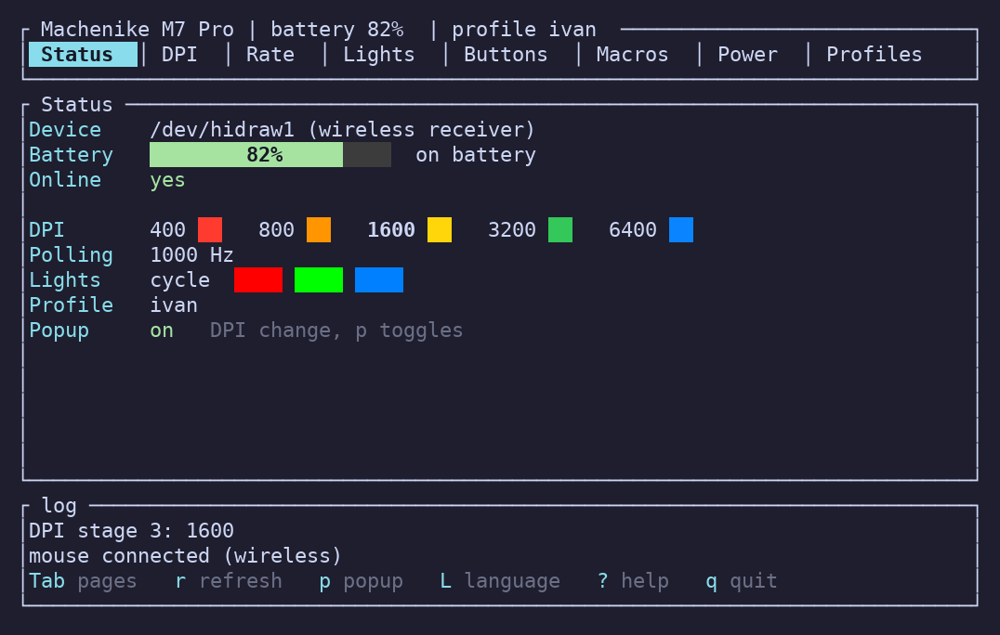
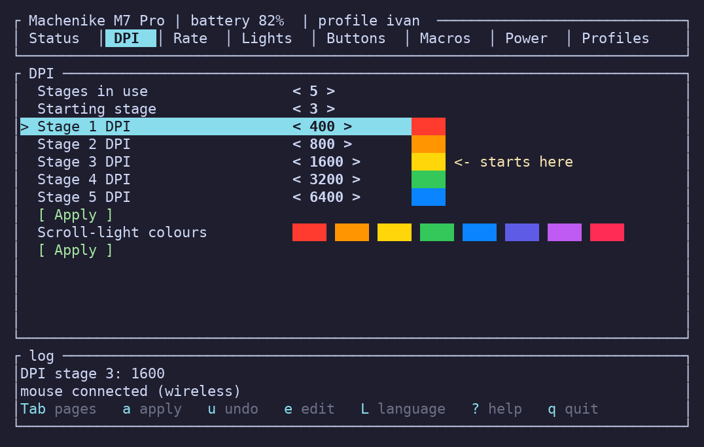
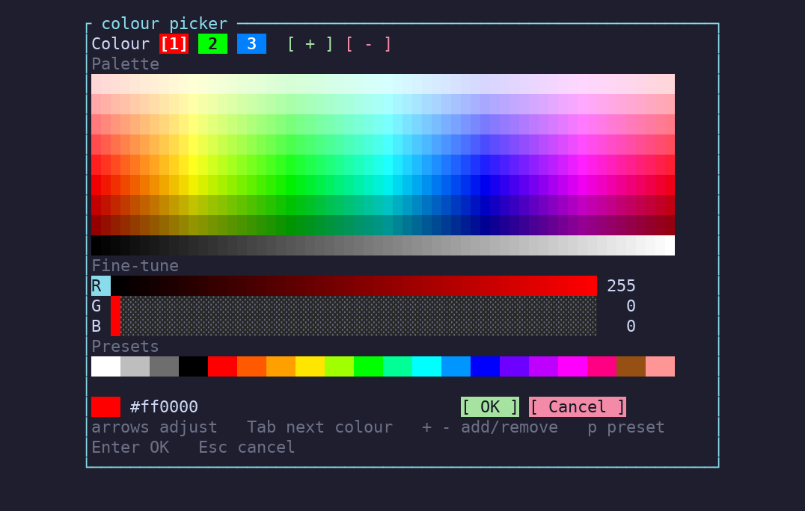

# m7ctl

[](https://github.com/IvanCraft623/m7ctl/actions/workflows/ci.yml)
[](https://github.com/IvanCraft623/m7ctl/releases/latest)
[](LICENSE)

Configure a **Machenike M7 Pro** mouse from the terminal on Linux, Windows and macOS: DPI, polling rate, buttons,
lighting, macros and profiles, with a command line and an interactive interface. Not affiliated with Machenike; use at
your own risk.

<p align="center"></p>

<table>
  <tr>
    <td></td>
    <td></td>
  </tr>
</table>

## Quick start

1. [Download](#download) m7ctl for your system and unpack it.
2. **Linux only:** run `./install.sh` once (it sets up access to the mouse), then replug the mouse.
3. Run **`m7ctl tui`** (`m7ctl.exe tui` on Windows): the interactive interface covers everything below.

In the interface: `Tab` or `1`-`8` switch pages, arrows select and change values, `Enter` applies, `e` types a number or
colour, `u` undoes, `?` shows all keys, `q` quits. The mouse works too, and the keys shown under the log can be clicked.

## Download

| System | Latest download |
|---|---|
| Linux x86_64 | [m7ctl-linux-x86_64.tar.gz](https://github.com/IvanCraft623/m7ctl/releases/latest/download/m7ctl-linux-x86_64.tar.gz) |
| Linux ARM64 | [m7ctl-linux-aarch64.tar.gz](https://github.com/IvanCraft623/m7ctl/releases/latest/download/m7ctl-linux-aarch64.tar.gz) |
| Windows x86_64 | [m7ctl-windows-x86_64.zip](https://github.com/IvanCraft623/m7ctl/releases/latest/download/m7ctl-windows-x86_64.zip) |
| Windows ARM64 | [m7ctl-windows-aarch64.zip](https://github.com/IvanCraft623/m7ctl/releases/latest/download/m7ctl-windows-aarch64.zip) |
| macOS (Intel and Apple Silicon) | [m7ctl-macos-universal.tar.gz](https://github.com/IvanCraft623/m7ctl/releases/latest/download/m7ctl-macos-universal.tar.gz) |

Older versions and `SHA256SUMS` are on the [releases page](https://github.com/IvanCraft623/m7ctl/releases). The binaries are
not code-signed, so the system warns the first time:

- **Windows:** SmartScreen shows "Windows protected your PC": click *More info*, then *Run anyway*.
- **macOS:** run `xattr -d com.apple.quarantine m7ctl` once after unpacking, or right-click the file and choose *Open*.

Tested on Linux with a wired mouse and the wireless receiver. The Windows and macOS builds are compiled and unit-tested in
CI but not yet tried on real hardware; reports are welcome (`m7ctl list --verbose` and `m7ctl status` output helps).

## Command line

```bash
m7ctl status                                 # model, battery, charging
m7ctl dpi 800,1600,3200 --active 2           # up to 8 stages
m7ctl rate 1000                              # polling rate in Hz
m7ctl button forward middle                  # give a button a function (see `m7ctl button --help`)
m7ctl light steady 0080ff --brightness 3     # also: cycle, breathing, flash, off
m7ctl dpi-colors ff0000,00ff00,0000ff        # scroll-light colour per DPI stage
m7ctl macro 1 "tap:ctrl+c,wait:100,tap:ctrl+v"
m7ctl button dpi macro:1,2,1                 # run slot 1 once per press
m7ctl profile save work                      # profile load / list / show / import <file.psf>
m7ctl watch --notify                         # popup whenever the DPI stage changes
```

The mouse stores its settings but cannot report them back, so m7ctl records what it last wrote; profiles are copies of
that record. Settings live in `~/.config/m7ctl`, `%APPDATA%\m7ctl` or `~/Library/Application Support/m7ctl`
(`M7CTL_CONFIG_DIR` overrides it).

## Troubleshooting

- **"permission denied" or no device found (Linux):** run `./install.sh` (or copy `dist/udev/70-machenike-m7.rules` to
  `/etc/udev/rules.d/`, then `sudo udevadm control --reload-rules`) and replug the mouse. Systems without systemd-logind
  need a `GROUP`/`MODE` rule instead of `TAG+="uaccess"`.
- **"the mouse is asleep":** a sleeping wireless mouse drops commands. Move it; m7ctl retries for about 12 seconds.
- **The interface looks broken:** use a terminal of at least 80x24.

## Build from source

```bash
cargo build --release          # needs a Rust toolchain
./dist/install.sh              # Linux: links m7ctl into ~/.local/bin and sets up mouse access
m7ctl tui
```

`--no-default-features` builds a CLI-only binary. The interface is English by default (`L` opens the language menu).
See [docs/protocol.md](docs/protocol.md) for the protocol and [docs/architecture.md](docs/architecture.md) for the code layout.
